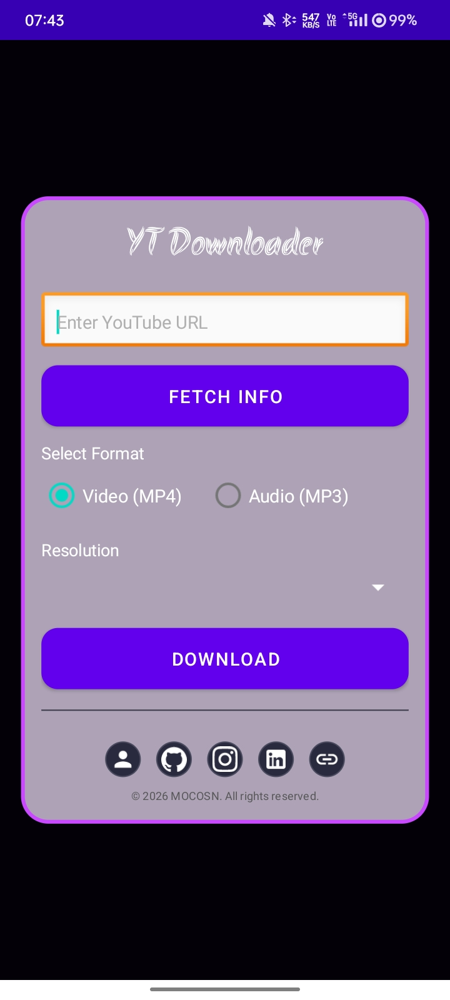
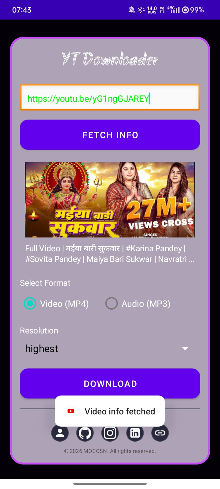
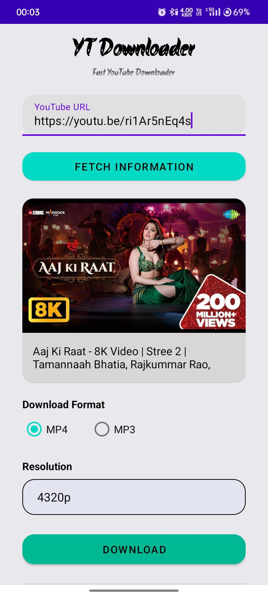
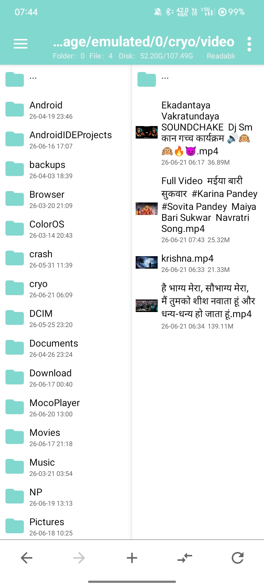

# YT Downloader

A lightweight Android application for downloading YouTube videos and audio, built with **Java** and **Chaquopy** (Python integration on Android).


## Features

- **YouTube Video Info Fetching** — Retrieve title, thumbnail, and available resolutions from any YouTube URL
- **MP4 Video Download** — Download videos in selectable resolutions (up to highest available)
- **MP3 Audio Download** — Extract audio-only streams in high bitrate MP3 format
- **Progress Tracking** — Real-time download progress with visual progress bar
- **Modern Light UI** — Material Design-inspired interface with custom gradients and animations

## Screenshots

| Main UI | Fetch Info |
|---------|-----------|
|  |  |

| Quality Selection | Downloaded Folder |
|-------------------|-------------------|
|  |  |

## Tech Stack

| Component | Technology |
|-----------|-----------|
| Language | Java 11 |
| Python Integration | Chaquopy 17.0.0 |
| Backend (Python) | Flask, pytubefix |
| Media Processing | FFmpegKit |
| Image Loading | Glide 4.16.0 |
| UI | AndroidX, Material Components |
| Build System | Gradle with Version Catalog |

## Architecture

```
app/
├── src/main/java/msn/mocosn/cryo/
│   └── MainActivity.java          # Android UI layer
├── src/main/python/
│   ├── app.py                      # Core download logic (pytubefix + FFmpegKit)
│   ├── app_proto.py               # Prototype/draft module
│   └── requirements.txt            # Python dependencies
├── build.gradle                    # App-level Gradle config
└── src/main/cpp/CMakeLists.txt     # Native build config
```

The app uses **Chaquopy** to embed Python code directly into the Android app. The Java layer handles UI and permissions, while the Python layer handles YouTube data extraction (`pytubefix`) and media processing (`FFmpegKit` via Java interop).

## Requirements

- **Android Studio** (Fox or newer recommended)
- **JDK 11**
- **Python 3.13** (installed at `C:\Users\mocosn\AppData\Local\Programs\Python\Python313\python.exe`)
- **Android SDK** with API level 36

## Building

1. Open the project in Android Studio
2. Sync Gradle dependencies
3. Ensure Python 3.13 path is correct in `app/build.gradle` (line 53)
4. Build and run on an emulator or physical device (ARM64 or x86_64)

```bash
# From project root
./gradlew assembleDebug
```

## Configuration

- **Min SDK**: 30 (Android 11)
- **Target SDK**: 36
- **Compile SDK**: 36
- **Python Version**: 3.13
- **Supported ABIs**: `arm64-v8a`, `x86_64`

## Permissions

- `INTERNET` — Fetch video metadata and download streams
- `READ_MEDIA_VIDEO` / `READ_MEDIA_AUDIO` — Access downloaded media (Android 13+)
- `WRITE_EXTERNAL_STORAGE` — Write to external storage (Android 12 and below)
- `MANAGE_EXTERNAL_STORAGE` — Full storage access for saving downloads

## Python Dependencies

```
pytubefix
```

## License

© 2026 MOCOSN. All rights reserved.

## Developer

- **Website**: [software.mocosn.in](https://software.mocosn.in)
- **GitHub**: [@MOCO-SN](https://github.com/MOCO-SN/)
- **LinkedIn**: [Sachin Patel](https://www.linkedin.com/in/sachin-patel-b5106a295/)
- **Instagram**: [@_sachin_2006_01](https://www.instagram.com/_sachin_2006_01/)
